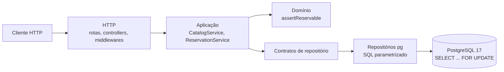

# TourFlow API — Projeto B | Projeto Final Full Cycle

**API REST de reservas turísticas com controle transacional de vagas, inclusive em pedidos simultâneos.**

[](https://github.com/podilon/tourflow-api/actions/workflows/ci.yml?query=branch%3Amain)
[](https://github.com/podilon/tourflow-api/actions/runs/43059539492)

**Evidência de referência:** CI de push em `main` no SHA `f0237c8`, com 100% de cobertura de linhas e branches em `src/domain/**` e `src/services/**`. [Run de referência](https://github.com/podilon/tourflow-api/actions/runs/43059539492)

[Guia rápido](#3-pré-requisitos-configuração-e-guia-rápido) · [Arquitetura](#2-arquitetura-e-stack) · [Artefatos](#artefatos-para-avaliação) · [Rubrica](#82-matriz-da-rubrica) · [Entrega](#83-entrega)

## Artefatos para avaliação

| Artefato | Onde consultar | O que demonstra |
| --- | --- | --- |
| Contrato OpenAPI 3.1 | [`docs/openapi.yaml`](docs/openapi.yaml) | Criação e consulta de reservas, schemas e respostas HTTP. |
| Decisão de arquitetura | [ADR-0001](docs/adr/0001-arquitetura.md) | Repository Pattern, alternativas e controle de concorrência. |
| Desempenho | [Relatório k6](docs/desempenho.md) · [Resultado oficial em JSON](performance/results/smoke-summary.json) | Método, p95 medido e resultado do SLO. |
| Planejamento e execução | [PRD](PRD.md) · [Roadmap](ROADMAP.md) | Escopo, rubrica e marcos do desenvolvimento. |
| Autoria e uso de IA | [CONTRIBUTORS.md](CONTRIBUTORS.md) · [Registro de IA](docs/ia.md) | Responsabilidade pela entrega, prompts relevantes e revisão humana. |

Para reproduzir o fluxo principal, siga o [guia rápido](#3-pré-requisitos-configuração-e-guia-rápido) e a [demonstração de ponta a ponta](#4-demonstração-de-ponta-a-ponta). Para conferir os requisitos do Projeto B, consulte a [matriz da rubrica](#82-matriz-da-rubrica).

## Sumário

1. [Visão geral e domínio](#1-visão-geral-e-domínio)
2. [Arquitetura e stack](#2-arquitetura-e-stack)
3. [Pré-requisitos, configuração e guia rápido](#3-pré-requisitos-configuração-e-guia-rápido)
4. [Demonstração de ponta a ponta](#4-demonstração-de-ponta-a-ponta)
5. [Testes e CI](#5-testes-e-ci)
6. [Saúde, observabilidade e desempenho](#6-saúde-observabilidade-e-desempenho)
7. [Decisões, governança e contribuição](#7-decisões-governança-e-contribuição)
8. [Roadmap, rubrica e entrega](#8-roadmap-rubrica-e-entrega)

## 1. Visão geral e domínio

### O problema

Uma agência de turismo receptivo vende experiências, como um passeio de barco, em **saídas** com data e capacidade fixas. Se dois clientes pedem as últimas vagas ao mesmo tempo, uma verificação ingênua ("há vagas? então grave") pode confirmar os dois pedidos. A saída fica com mais passageiros do que comporta, e a agência precisa cancelar, reembolsar e se desculpar.

O TourFlow API resolve esse ponto num escopo pequeno e verificável: a confirmação de uma reserva e a ocupação das vagas acontecem juntas, sob bloqueio no PostgreSQL. Um pedido que excede as vagas restantes recebe `409` e não grava nada.

### Quem usa

No escopo do projeto ([PRD](PRD.md) §2), a API é consumida por um **operador ou integrador HTTP** que consulta o catálogo e solicita reservas, por exemplo um sistema de balcão ou de parceiro. Não há autenticação nem painel web. A API roda apenas em ambiente local e educacional, publicada em `127.0.0.1`.

### Fronteiras do domínio

| Área | Responsabilidade | Rotas | Onde está no código |
| --- | --- | --- | --- |
| **Catálogo** | Experiências e saídas, somente leitura | `GET /experiences`, `GET /departures` | `CatalogService` (`src/services/catalog-service.ts`), `CatalogRepository` |
| **Disponibilidade** | Vagas livres = `capacity − reserved_seats` | Campo `availableSeats` de `GET /departures` | Exibida pelo `CatalogService`; decidida por `availableSeats` e `assertReservable` em `src/domain/reservation.ts` |
| **Reservas** | Confirmar e consultar reservas sem exceder a capacidade | `POST /reservations`, `GET /reservations/:id` | `ReservationService`, `ReservationRepository` e a transação em `src/repositories/pg/pg-reservation-repository.ts` |

O `availableSeats` do catálogo é **informativo**: pode mudar entre a consulta e o pedido. A decisão vale somente dentro da transação de reserva, com a saída bloqueada.

**Fora do escopo** ([PRD](PRD.md) §3.3): autenticação, pagamento, cancelamento, painel web, cache, filas, microsserviços, deploy e dados reais.

## 2. Arquitetura e stack

Monólito REST em camadas com **Repository Pattern** e injeção de dependências manual, conforme o [ADR-0001](docs/adr/0001-arquitetura.md).



- **HTTP** (`src/http/`): valida a entrada com Zod, traduz resultados e erros para HTTP, gera o request ID e escreve o log.
- **Aplicação** (`src/services/`): orquestra os casos de uso, serializa datas e notifica a métrica depois da confirmação.
- **Domínio** (`src/domain/reservation.ts`): schema do payload e regras de reserva (saída inexistente, encerrada ou sem vagas).
- **Repositórios** (`src/repositories/`): contratos pequenos; as implementações em `src/repositories/pg/` executam SQL parametrizado.
- **Composição** (`src/server.ts`): único ponto que cria pool, repositórios, services, logger e métricas e os injeta em `createApp` (`src/app.ts`).

### Onde a capacidade é protegida

Em `src/repositories/pg/pg-reservation-repository.ts`, numa única conexão e transação:

1. `BEGIN` com `lock_timeout` de 1,5 s, `statement_timeout` de 1,8 s e `idle_in_transaction_session_timeout` de 5 s.
2. `SELECT ... FROM departures WHERE id = $1 FOR UPDATE` bloqueia a linha da saída. Um pedido concorrente para a mesma saída espera aqui.
3. `SELECT clock_timestamp()` lê o relógio **depois** do bloqueio.
4. A regra `assertReservable`, recebida do domínio como `guard`, decide: saída inexistente → `404`; encerrada → `409 DEPARTURE_CLOSED`; sem vagas → `409 NO_AVAILABILITY`.
5. `INSERT` da reserva e `UPDATE departures SET reserved_seats = reserved_seats + $2`.
6. `COMMIT`. Qualquer falha provoca `ROLLBACK`, e uma conexão em estado incerto é descartada.

No banco, as constraints `CHECK (reserved_seats >= 0)` e `departures_reserved_seats_within_capacity` (`CHECK (reserved_seats <= capacity)`) funcionam como segunda barreira. Os dois testes de concorrência da [seção 5](#51-testes) comprovam o comportamento contra PostgreSQL real.

### Stack

| Tecnologia | Função | Versão usada (fonte) | Mínimo comprovado |
| --- | --- | --- | --- |
| Node.js | Runtime | 24.22.2, Alpine 3.24.4, por digest (`Dockerfile`) | `>=24 <25` (`engines` em `package.json`) |
| TypeScript | Linguagem, ESM | 6.0.3 (`package-lock.json`) | — |
| Express | Servidor HTTP | 5.3.0 (`package-lock.json`) | — |
| Zod | Validação de entrada e configuração | 4.6.7 (`package-lock.json`) | — |
| PostgreSQL | Persistência, transações e bloqueio de linha | `postgres:17.11-alpine`, por digest (`docker-compose.yml`) | — |
| pg | Driver PostgreSQL | 8.23.1 (`package-lock.json`) | — |
| Pino | Logs JSON | 10.4.0 (`package-lock.json`) | — |
| prom-client | Métrica Prometheus | 15.1.3 (`package-lock.json`) | — |
| Vitest, `@vitest/coverage-v8` | Testes e cobertura | 5.1.0 e 5.1.0 (`package-lock.json`) | — |
| Supertest | Testes HTTP | 7.3.2 (`package-lock.json`) | — |
| ESLint | Lint | 10.14.0 (`package-lock.json`) | — |
| `@apidevtools/swagger-parser` | Validação do OpenAPI | 13.1.0 (`package-lock.json`) | — |
| k6 | Smoke de desempenho | `grafana/k6:1.0.0`, por digest (`docker-compose.yml`) | — |
| Docker Compose | Orquestração local e no CI | v5.6.1 na medição local ([docs/desempenho.md](docs/desempenho.md)); runner `ubuntu-latest` no CI | Compose v2 com suporte a `env_file.required` (v2.24.0 ou superior, conforme a documentação do Docker) |

Todas as dependências npm estão fixadas em versões exatas, com lockfile. A imagem `runtime` roda como usuário não-root `node`, sem devDependencies, e tem `HEALTHCHECK` em `/health`.

## 3. Pré-requisitos, configuração e guia rápido

### O que instalar no host

- **Docker** com **Docker Compose v2**: Docker Desktop no Windows ou macOS, Docker Engine no Linux.
- **Git**.
- Porta `3000` livre em `127.0.0.1`. Para outra porta, veja o [ambiente paralelo](#ambiente-paralelo-isolado).

Node.js e npm **não** são necessários no host. Node.js, npm, lint, testes, build e k6 rodam em containers.

**Shell dos exemplos:** `bash`. No Windows, use o **Git Bash**, instalado com o Git. Os comandos `docker compose` funcionam igual no PowerShell. Os exemplos com `curl` usam aspas simples do bash; para os `POST`, use o Git Bash.

### Configuração

O arquivo [`.env.example`](.env.example) documenta as variáveis e contém **apenas placeholders**. Copiar para `.env` é opcional: sem `.env`, o Compose usa padrões locais e fictícios.

- O `.env` é ignorado pelo Git ([`.gitignore`](.gitignore)). `.env.example` é o único arquivo `.env*` versionado.
- **Nunca faça commit de credenciais**, nem em `.env.example`. Use apenas valores locais e fictícios.
- Nenhum banco publica porta no host. Por isso, a senha local padrão não fica exposta fora da rede do Compose.

| Variável | Finalidade | Obrigatória | Padrão |
| --- | --- | --- | --- |
| `TOURFLOW_DB_PASSWORD` | Senha dos bancos `db` e `db-test`. O PostgreSQL só a lê ao criar o volume; trocá-la depois exige recriar o banco, o que apaga os dados. | Não | Senha local fictícia definida no `docker-compose.yml` |
| `NODE_ENV` | Modo de execução, validado por `src/config/env.ts` | Não | `development` no `.env.example`; o Compose fixa `production` no serviço `api` |
| `HOST`, `PORT` | Endereço de escuta da API dentro do container | Não | `0.0.0.0` e `3000`, fixados pelo Compose no serviço `api` |
| `DB_HOST`, `DB_PORT`, `DB_NAME`, `DB_USER` | Alvo do PostgreSQL | Não editar | `db`, `5432`, `tourflow`, `tourflow`, fixados pelo Compose. Variáveis `PG*` e `DATABASE_URL` são **rejeitadas** pela API |
| `COMPOSE_PROJECT_NAME` | Nome do projeto Compose | Não | `tourflow` |
| `TOURFLOW_API_PORT` | Porta da API no host, sempre em `127.0.0.1` | Não | `3000` |
| `TOURFLOW_PGDATA_VOLUME` | Volume do banco de desenvolvimento | Não | `tourflow_pgdata` |
| `TOURFLOW_NODE_MODULES_VOLUME` | Volume do `node_modules` do serviço `dev` | Não | `tourflow_dev_node_modules` |
| `TOURFLOW_IMAGE_TAG` | Tag das imagens `tourflow-api` e `tourflow-dev` | Não | `local` |

### Guia rápido

```bash
# 1. Clonar
git clone https://github.com/podilon/tourflow-api.git
cd tourflow-api

# 2. (Opcional) Configuração local
cp .env.example .env

# 3. Construir e subir API + PostgreSQL, aguardando os healthchecks
docker compose up --build -d --wait api
docker compose ps

# 4. Aplicar o schema (migrations) e o catálogo fictício (seed)
docker compose run --rm --no-deps api node dist/infra/db/migrate.js
docker compose run --rm --no-deps api node dist/infra/db/seed.js

# 5. Verificar a saúde
curl -i http://127.0.0.1:3000/health
```

| Passo | Resultado esperado |
| --- | --- |
| 3 | `db` e `api` com estado `healthy`; `api` em `127.0.0.1:3000->3000/tcp`; `db` só com `5432/tcp` interno. O primeiro build baixa as imagens base e demora mais. |
| 4, migration | `Created schema_migrations`, `Applied migration 0001_initial_schema` e `Applied 1 migration(s)` na primeira vez; `No pending migrations` nas seguintes. |
| 4, seed | `Seed inserted 2 experience(s) and 4 departure(s)` na primeira vez; `Seed inserted 0 experience(s) and 0 departure(s)` nas seguintes. |
| 5 | `HTTP/1.1 200 OK` e `{"status":"ok","database":"up"}`. |

**Migrations e seed são idempotentes e não destrutivos.** Antes de gravar, os dois comandos conferem o alvo: host `db`, porta `5432`, banco `tourflow` e, já conectados, `current_database()` e `inet_server_port()`. A migration usa transação e advisory lock. A seed usa `ON CONFLICT DO NOTHING` e nunca altera linhas existentes, reservas nem `reserved_seats`. As quatro saídas começam às 09:00 UTC, 7, 10, 14 e 21 dias depois da data UTC da primeira execução da seed.

### Ambiente paralelo isolado

Para rodar uma segunda cópia, como um clone de ensaio, sem tocar no ambiente existente, defina no `.env` dessa cópia:

```dotenv
COMPOSE_PROJECT_NAME=tourflow_clean
TOURFLOW_API_PORT=3100
TOURFLOW_PGDATA_VOLUME=tourflow_clean_pgdata
TOURFLOW_NODE_MODULES_VOLUME=tourflow_clean_dev_node_modules
TOURFLOW_IMAGE_TAG=clean
```

Os comandos continuam os mesmos; nos exemplos HTTP, troque `3000` por `3100`. Antes de subir, confira a configuração efetiva com `docker compose config`.

### Parar

```bash
docker compose --profile test stop api db db-test   # ou: docker compose down
```

**Nunca use `docker compose down -v`**: o comando apaga os volumes do projeto, inclusive o banco de desenvolvimento (`tourflow_pgdata`).

## 4. Demonstração de ponta a ponta

**Pré-condição:** os passos 1 a 5 do guia rápido concluídos. Os IDs de experiência e de saída são os **IDs fixos da seed**, todos fictícios. As datas (`startsAt`) dependem do dia em que a seed rodou. O `id` e o `createdAt` de uma reserva são gerados pela API e serão diferentes no seu ambiente.

### 4.1 Catálogo

```bash
curl http://127.0.0.1:3000/experiences
```

```json
[
  {"id":"8f0c2a1e-1b6d-4c1a-9a51-0d2b6f1e7a01","name":"Passeio de barco fictício pela baía","description":"Experiência sintética para demonstração do TourFlow API.","durationMinutes":180},
  {"id":"8f0c2a1e-1b6d-4c1a-9a51-0d2b6f1e7a02","name":"Trilha fictícia ao mirante","description":"Experiência sintética para demonstração do TourFlow API.","durationMinutes":240}
]
```

### 4.2 Saídas e disponibilidade

```bash
curl http://127.0.0.1:3000/departures
curl "http://127.0.0.1:3000/departures?experienceId=8f0c2a1e-1b6d-4c1a-9a51-0d2b6f1e7a01"
```

Num banco recém-criado, a saída usada na demonstração aparece assim:

```json
{"id":"3c9e7b52-6a0f-4d8e-8b1c-5f2a9d4e6b01","experienceId":"8f0c2a1e-1b6d-4c1a-9a51-0d2b6f1e7a01","startsAt":"2026-11-18T09:00:00.000Z","capacity":12,"availableSeats":12,"priceCents":18900}
```

| Saída (seed) | Experiência | Capacidade | Dia após a seed |
| --- | --- | ---: | ---: |
| `3c9e7b52-6a0f-4d8e-8b1c-5f2a9d4e6b01` | Passeio de barco | 12 | 7 |
| `3c9e7b52-6a0f-4d8e-8b1c-5f2a9d4e6b02` | Passeio de barco | 12 | 14 |
| `3c9e7b52-6a0f-4d8e-8b1c-5f2a9d4e6b03` | Trilha | 8 | 10 |
| `3c9e7b52-6a0f-4d8e-8b1c-5f2a9d4e6b04` | Trilha | 8 | 21 |

### 4.3 Criar uma reserva

> **Este comando grava dados.** Cada execução bem-sucedida cria uma nova reserva e consome 2 vagas. Depois de 6 execuções, a saída `…6b01` fica lotada e o mesmo comando passa a responder `409 NO_AVAILABILITY`. A seed não desfaz reservas. Para repetir a demonstração, use outra saída da tabela acima.

```bash
curl -i -X POST http://127.0.0.1:3000/reservations \
  -H 'Content-Type: application/json' \
  -d '{"departureId":"3c9e7b52-6a0f-4d8e-8b1c-5f2a9d4e6b01","customerName":"Cliente Ficticio","customerEmail":"cliente@example.test","participants":2}'
```

Resposta (o `id` e o `createdAt` serão outros):

```text
HTTP/1.1 201 Created
Location: /reservations/9c08f28d-1577-438f-848b-0ccc191e0bb0
X-Request-Id: <uuid gerado pela API>

{"id":"9c08f28d-1577-438f-848b-0ccc191e0bb0","departureId":"3c9e7b52-6a0f-4d8e-8b1c-5f2a9d4e6b01","participants":2,"status":"CONFIRMED","createdAt":"2026-11-11T14:03:52.812Z"}
```

Nome e e-mail são gravados, mas **nunca devolvidos** nem registrados em log.

### 4.4 Consultar a reserva e a ocupação

```bash
curl -i http://127.0.0.1:3000/reservations/<id-da-resposta>
curl "http://127.0.0.1:3000/departures?experienceId=8f0c2a1e-1b6d-4c1a-9a51-0d2b6f1e7a01"
```

A consulta devolve `200` com o mesmo corpo do `201`. A saída `…6b01` passa a mostrar `"availableSeats":10`.

### 4.5 Exceder a capacidade (409)

Peça mais participantes do que as vagas restantes. Com 10 vagas, 11 participantes bastam:

```bash
curl -i -X POST http://127.0.0.1:3000/reservations \
  -H 'Content-Type: application/json' \
  -d '{"departureId":"3c9e7b52-6a0f-4d8e-8b1c-5f2a9d4e6b01","customerName":"Cliente Ficticio","customerEmail":"cliente@example.test","participants":11}'
```

```text
HTTP/1.1 409 Conflict

{"error":{"code":"NO_AVAILABILITY","message":"Not enough available seats"}}
```

Repita a consulta de saídas: `availableSeats` continua `10`, porque o pedido rejeitado não grava nada. Se já houver outras reservas nessa saída, use um valor maior que o `availableSeats` atual. Como a capacidade é 12, `"participants":20` sempre excede as vagas.

### 4.6 Outros erros

| Pedido | Resposta |
| --- | --- |
| `GET /reservations/00000000-0000-4000-8000-000000000000` | `404` `{"error":{"code":"NOT_FOUND","message":"Reservation not found"}}` |
| `GET /reservations/abc` | `400` `{"error":{"code":"VALIDATION_ERROR","message":"Invalid reservation id"}}` |
| `POST /reservations` com `"participants":0` ou propriedade desconhecida | `400` `{"error":{"code":"VALIDATION_ERROR","message":"Invalid reservation payload"}}` |
| `GET /departures?experienceId=abc` | `400` `{"error":{"code":"VALIDATION_ERROR","message":"Invalid query parameters"}}` |
| Rota desconhecida | `404` `{"error":{"code":"NOT_FOUND","message":"Resource not found"}}` |

A saída encerrada (`409 DEPARTURE_CLOSED`) não ocorre com a seed, cujas saídas são futuras. Esse caso é comprovado pelos testes de integração.

**Evidência registrada:** o fluxo foi executado em 11/11/2026 com a reserva fictícia `9c08f28d-1577-438f-848b-0ccc191e0bb0`. O registro está em [docs/estado-execucao.md](docs/estado-execucao.md), no checkpoint do Bloco 1. A consulta e o `409` foram repetidos na revisão da F5, dentro do container `api`, com o mesmo resultado.

### 4.7 Contrato HTTP

| Método | Rota | Sucesso | Erros relevantes | Documentação |
| --- | --- | --- | --- | --- |
| `GET` | `/health` | `200` | `503 UNAVAILABLE` | [Seção 6](#61-saúde) |
| `GET` | `/experiences` | `200` array | `500 INTERNAL_ERROR` | [4.1](#41-catálogo) |
| `GET` | `/departures?experienceId=<uuid>` | `200` array | `400 VALIDATION_ERROR`, `500` | [4.2](#42-saídas-e-disponibilidade) |
| `POST` | `/reservations` | `201` + `Location` | `400`, `404 NOT_FOUND`, `409 NO_AVAILABILITY`, `409 DEPARTURE_CLOSED`, `500` | [OpenAPI](docs/openapi.yaml) |
| `GET` | `/reservations/{id}` | `200` | `400`, `404`, `500` | [OpenAPI](docs/openapi.yaml) |
| `GET` | `/metrics` | `200` texto Prometheus | `500` | [Seção 6](#63-métrica) |

- Todo erro segue `{"error":{"code":"<CÓDIGO>","message":"..."}}`, com mensagem fixa, sem eco da entrada e sem stack trace. Toda resposta traz `X-Request-Id`.
- Validação de `POST /reservations` (Zod, strict): `departureId` UUID; `customerName` de 1 a 120 caracteres depois de aparar espaços; `customerEmail` válido, até 254 caracteres; `participants` inteiro de 1 a 20; propriedades desconhecidas rejeitadas. JSON malformado ou corpo acima de 16 KB → `400`.
- Filtro `experienceId`: UUID enviado ao SQL como parâmetro. UUID sem experiência → `200 []`. Filtro inválido, vazio, repetido ou parâmetro desconhecido → `400`.

**OpenAPI 3.1:** [docs/openapi.yaml](docs/openapi.yaml) cobre **somente as rotas de reserva**, `POST /reservations` e `GET /reservations/{id}`, com schemas, cabeçalhos `Location` e `X-Request-Id` e exemplos fictícios. Catálogo, saúde e métrica estão documentados apenas neste README. O documento é validado por `tests/unit/openapi.test.ts` com `@apidevtools/swagger-parser`. O teste também confere que o exemplo de requisição é aceito pelo schema Zod da API e que a resposta `201` real tem exatamente as propriedades do schema `Reservation`.

## 5. Testes e CI

As ferramentas rodam no serviço `dev` (profile `dev`). O código entra por bind mount, e o `node_modules` fica no volume `tourflow_dev_node_modules`, nunca no host. Prepare a imagem uma vez:

```bash
docker compose --profile dev build dev
```

### 5.1 Testes

| Suíte | Comando | Dependências do ambiente | Quantidade |
| --- | --- | --- | ---: |
| Unitários | `docker compose run --rm dev npm run test:unit` | Somente a imagem `dev`. Sem banco; repositórios fake | 122 em 7 arquivos |
| Integração | ver abaixo | Imagem `dev` + `db-test` (PostgreSQL 17 em tmpfs, banco `tourflow_test`) | 10 |

```bash
docker compose --profile test up -d --wait db-test
docker compose run --rm --no-deps dev npm run test:integration
docker compose --profile test stop db-test   # descarta o tmpfs
```

- **Unitários** (`tests/unit/`): regras do domínio, services, controllers, repositório PostgreSQL com cliente fake, health, observabilidade e OpenAPI.
- **Integração** (`tests/integration/reservations.test.ts`): caso feliz com persistência e consulta, `400`, `404`, `409 NO_AVAILABILITY`, `409 DEPARTURE_CLOSED`, métrica (`201` incrementa, `409` não) e duas provas de concorrência:
  - dois pedidos de 2 vagas numa saída de capacidade 3, com as duas esperas pelo bloqueio observadas em `pg_stat_activity`: um `201`, um `409`, uma reserva e `reserved_seats = 2`;
  - uma saída que se encerra durante a espera: `409 DEPARTURE_CLOSED`, nada gravado.
- Antes de aplicar o schema ou gravar fixtures, a suíte confere host `db-test`, porta `5432`, banco `tourflow_test`, `current_database()` e `inet_server_port()`, e aborta se algo divergir (`tests/helpers/test-db.ts`).

### 5.2 Cobertura

```bash
docker compose run --rm dev npm run test:coverage
```

| Item | Valor |
| --- | --- |
| Escopo | Todos os arquivos de `src/domain/**/*.ts` e `src/services/**/*.ts`, inclusive os não importados por testes (entram com 0%) |
| Limiares | **80% de linhas** e **80% de branches** (`vitest.config.ts`); o comando falha abaixo de qualquer um |
| Medido | 100% de linhas (32/32) e 100% de branches (9/9) em `src/domain/reservation.ts`, `src/services/catalog-service.ts` e `src/services/reservation-service.ts` |
| Fora do escopo | Bootstrap, HTTP e infraestrutura (PRD RNF-04), exercitados pelos testes de rota e de integração |

Lint, typecheck e build:

```bash
docker compose run --rm dev npm run lint        # ESLint, zero avisos
docker compose run --rm dev npm run typecheck   # tsc --noEmit
docker compose run --rm dev npm run build       # tsc para dist/
```

Depois de mudar o `package-lock.json`, sincronize o volume com `docker compose --profile dev build dev` seguido de `docker compose run --rm dev npm ci`. Nenhum container instala dependências ao iniciar.

### 5.3 CI no GitHub Actions

[`.github/workflows/ci.yml`](.github/workflows/ci.yml) roda em `push` e `pull_request` para `main` e `develop`, num runner hospedado `ubuntu-latest` (sem self-hosted), com `GITHUB_TOKEN` somente leitura. O job `Foundation (Compose lint, typecheck, test, build)` usa um projeto Compose próprio do run: valida o Compose, constrói a imagem `dev` (`npm ci`), roda lint, typecheck e `test:coverage`, sobe o `db-test` do job, roda `test:integration` e o build. Ao final, os containers são encerrados sem `-v`. O banco de desenvolvimento não participa.

### 5.4 Resultados por origem

| Origem | SHA | Lint, typecheck e build | Unitários e cobertura | Integração | Evidência |
| --- | --- | --- | --- | --- | --- |
| Clone limpo (F4-T5, 11/11/2026) | `2820b89d03a1799fafdc46e1838a1c1391aa8142` | exit 0 | 122/122; 100% linhas e branches | 10/10 | [docs/estado-execucao.md](docs/estado-execucao.md), F4-T5 |
| GitHub Actions, push em `main` | `f0237c8bb653cc1262bbd97b86d4f10d981b42d7` | sucesso | 122/122; `All files` 100% | 10/10 | [run 43059539492](https://github.com/podilon/tourflow-api/actions/runs/43059539492) |

O clone foi executado localmente, num diretório novo e com projeto Compose isolado. O GitHub Actions executou no runner hospedado. As quantidades e a cobertura do run foram lidas no log do job.

## 6. Saúde, observabilidade e desempenho

### 6.1 Saúde

```bash
curl -i http://127.0.0.1:3000/health
```

| Situação | Resposta |
| --- | --- |
| API e banco disponíveis | `200` `{"status":"ok","database":"up"}` |
| Banco inacessível | `503` `{"error":{"code":"UNAVAILABLE","message":"Database is unavailable"}}`. A API continua no ar e volta a `200` quando o banco retorna |

O `HEALTHCHECK` da imagem consulta essa rota; com o banco parado, `docker compose ps` mostra a `api` como `unhealthy`.

### 6.2 Logs e request ID

```bash
docker compose logs --tail 20 api
```

Uma linha JSON (Pino) por requisição, escrita ao fim da resposta (`src/http/middlewares/request-context.ts`). Exemplo real de erro de validação:

```json
{"level":40,"time":"2026-11-11T14:38:38.210Z","requestId":"b584dd65-4abc-4cbb-97d1-5dfe2974f6d1","method":"GET","route":"/departures","statusCode":400,"durationMs":2.196,"errorCode":"VALIDATION_ERROR","msg":"request completed"}
```

- `requestId` (UUID v4) é gerado pela API e devolvido no cabeçalho `X-Request-Id`; um valor enviado pelo cliente é ignorado. Use-o para localizar a linha de log de uma resposta.
- `route` é o padrão da rota (`/reservations/:id`), nunca a URL bruta; rota desconhecida aparece como `unmatched`.
- Não são registrados query string, corpo, cabeçalhos, nome, e-mail, credenciais nem o objeto de erro.
- `errorCode` aparece só em respostas de erro. Nível: `info` (< 400), `warn` (4xx), `error` (5xx).

### 6.3 Métrica

```bash
docker compose exec -T api node -e "fetch('http://127.0.0.1:3000/metrics').then(async r => console.log(r.status, await r.text()))"
```

O exemplo roda dentro do container, como na evidência registrada; a rota também é publicada em `http://127.0.0.1:3000/metrics`. Trecho da resposta (o valor do contador depende das reservas confirmadas desde o início do processo):

```text
# HELP tourflow_reservations_confirmed_total Reservas confirmadas e gravadas no banco (após COMMIT).
# TYPE tourflow_reservations_confirmed_total counter
tourflow_reservations_confirmed_total 0
```

- `GET /metrics` → `200`, formato Prometheus, a partir de um `Registry` próprio (`src/infra/metrics.ts`), sem as métricas padrão do processo.
- `tourflow_reservations_confirmed_total` incrementa **somente depois do `COMMIT`** de uma reserva. Respostas 400, 404 e 409 não incrementam. O contador é por processo e volta a zero quando a API reinicia.

### 6.4 SLO, p95 e smoke k6

| Medida | O que avalia | Meta |
| --- | --- | --- |
| **SLO educacional** (`slo_departures_ok`) | Proporção de `GET /departures` com HTTP 200 **e** duração < 500 ms | ≥ 99%, com amostra mínima de 200 requisições; abaixo disso, **inconclusivo** |
| **p95** de `http_req_duration` | Latência abaixo da qual ficam 95% das requisições | `p(95)<500` |

As duas medidas são avaliadas separadamente: um p95 baixo não prova o SLO, e o SLO não informa o p95.

Para reproduzir, com `api` e `db` no ar e a seed aplicada:

```bash
docker compose --profile perf run --rm --no-deps k6 run smoke.js
```

O cenário é 1 VU por 30 s em `GET /departures`, somente leitura. O script está em [performance/smoke.js](performance/smoke.js). Executar de novo **sobrescreve** `performance/results/smoke-summary.json`; a evidência oficial é a versão no Git.

| Execução | Requisições | p95 | SLO |
| --- | ---: | ---: | --- |
| **Oficial** (ambiente `tourflow`) | 572 | **1,913 ms** | **100%**, ATINGIDO |
| Ensaio em clone limpo (`tourflow_clean`) | 571 | 2,063 ms | 100%, ATINGIDO |

Método, ambiente, resumos brutos, ressalvas do clone e limites da amostra: [docs/desempenho.md](docs/desempenho.md).

## 7. Decisões, governança e contribuição

### 7.1 Documentos de referência

| Documento | Conteúdo |
| --- | --- |
| [PRD.md](PRD.md) | Problema, escopo, requisitos, critérios de aceite e rastreabilidade com a rubrica (§8) |
| [docs/adr/0001-arquitetura.md](docs/adr/0001-arquitetura.md) | Decisão arquitetural, alternativas rejeitadas, consequências e evidências no código |
| [docs/openapi.yaml](docs/openapi.yaml) | Contrato OpenAPI 3.1 das rotas de reserva |
| [ROADMAP.md](ROADMAP.md) | Fases, tarefas, critérios, gates e situação atual |
| [docs/desempenho.md](docs/desempenho.md) | Relatório do smoke k6 e do SLO |
| [docs/ia.md](docs/ia.md) | Uso de IA por fase |
| [docs/estado-execucao.md](docs/estado-execucao.md) | Diário de execução, comandos e evidências |
| [CLAUDE.md](CLAUDE.md), [docs/governanca.md](docs/governanca.md) | Regras de trabalho do agente de IA e controles de permissão |

### 7.2 SOLID no código

| Princípio | Arquivo ou componente | Evidência | Limitação |
| --- | --- | --- | --- |
| SRP | `src/http/controllers/*`, `src/services/*`, `src/repositories/pg/*`, `src/domain/reservation.ts`, `src/http/middlewares/request-context.ts` | Controllers validam a entrada e traduzem para HTTP; o domínio decide saída inexistente, encerrada ou sem vagas; services orquestram e serializam; repositórios executam SQL parametrizado e a transação. Log e métrica ficam em `src/infra/` e no middleware, fora das regras. | O controller de reservas mapeia `DomainError` para status HTTP; é tradução de transporte, não regra. |
| DIP | `src/services/reservation-service.ts`, `src/services/catalog-service.ts`, `src/server.ts` | Os services importam apenas os tipos `ReservationRepository`/`CatalogRepository` e recebem a métrica como callback `onConfirmed`, sem depender de `pg` nem de `prom-client`. A composição concreta ocorre só em `src/server.ts`. | `src/app.ts` cria, por padrão, um logger desligado e um `Registry` novo quando nada é injetado (conveniência para os testes). |
| ISP | `src/repositories/reservation-repository.ts`, `src/repositories/catalog-repository.ts`, `ReservationPool`/`TransactionClient` em `pg-reservation-repository.ts` | Contratos pequenos e separados por consumidor: leitura de catálogo (2 métodos), reservas (2 métodos); os repositórios PostgreSQL pedem só `query`/`connect`/`release`, não o `Pool` inteiro. | — |
| LSP | Fakes em `tests/unit/reservation.test.ts`, `tests/unit/catalog.test.ts` e `tests/unit/observability.test.ts` × `tests/integration/reservations.test.ts` | Os mesmos services e controllers rodam com repositórios fake (unitários) e com os repositórios PostgreSQL (integração no `db-test`), sem alteração de código, e produzem os mesmos contratos HTTP. | Há apenas duas implementações de cada contrato (PostgreSQL e fake de teste). |
| OCP | — | **Não demonstrado** como extensão de produção: não há variação real de comportamento que justifique pontos de extensão, e nenhum foi criado por antecipação. A substituição de repositórios nos testes está registrada em LSP. | Abstrações artificiais foram evitadas de propósito (YAGNI). |

SRP, DIP, ISP e LSP têm evidência direta no código. OCP não é demonstrado. A fórmula de `availableSeats` aparece no `CatalogService`, para exibição, e no domínio, para a decisão.

### 7.3 Fluxo de branches, commits e checks

| Regra | Tipo | Como é garantida |
| --- | --- | --- |
| `main` e `develop` são permanentes; não podem ser excluídas nem receber force push | **Aplicada pelo GitHub** | Ruleset `Protect permanent branches` (regras `deletion` e `non_fast_forward`), ativo, sem bypass |
| Mudanças em `main` e `develop` entram só por PR, com o check `Foundation (Compose lint, typecheck, test, build)` verde | **Aplicada pelo GitHub** | Ruleset `Require TourFlow CI before merge` (regras `pull_request` e `required_status_checks`), ativo, sem bypass; 0 aprovações exigidas |
| Branch curta é excluída no remoto após o merge | **Aplicada pelo GitHub** | Configuração `delete_branch_on_merge` do repositório |
| Tarefas partem de `develop` em branches curtas (`feat/…`, `chore/…`, `docs/…`) e voltam a ela por PR; entregas são promovidas de `develop` para `main` por PR | Convenção adotada | `CLAUDE.md` §5 e `docs/governanca.md` §13 |
| Mensagens de commit com prefixo `feat:`, `docs:`, `ci:`, `chore:`, `test:` ou `perf:` e o ID da tarefa | Convenção adotada | `CLAUDE.md` §10; seguida no histórico, sem validação automática |
| Merge com `--match-head-commit` no SHA revisado | Convenção adotada | `docs/governanca.md` §14 |
| Cada tarefa segue Plan → Approve → Execute → Verify, com aprovação humana | Convenção adotada | `CLAUDE.md` §6 |

Os payloads dos rulesets estão versionados em `.github/rulesets/`. O estado ativo foi conferido pela API do GitHub em 11/11/2026.

**Para contribuir:** crie uma branch curta a partir de `develop`, rode lint, typecheck, testes e build pelo Compose ([seção 5](#5-testes-e-ci)), abra um PR para `develop` e aguarde o check `Foundation`. Não faça commit de `.env` nem de credenciais.

## 8. Roadmap, rubrica e entrega

### 8.1 Roadmap executado

| Fase | Status | Entrega | Evidência |
| --- | --- | --- | --- |
| F0 — Planejamento | Concluída; G0 em 08/11 | PRD, ADR, governança e roadmap v1.1 | Commit [`d9b59b3`](https://github.com/podilon/tourflow-api/commit/d9b59b3d1a4198626619639a9ba6ac50f1c24310) |
| F1 — Fundação e API | Concluída | Permissões, Docker-first, PostgreSQL, migrations, seed, `/health`, catálogo, reservas com `FOR UPDATE`, E2E manual | Commit `1b8bd05`; PRs [#1](https://github.com/podilon/tourflow-api/pull/1), [#6](https://github.com/podilon/tourflow-api/pull/6), [#7](https://github.com/podilon/tourflow-api/pull/7), [#8](https://github.com/podilon/tourflow-api/pull/8) |
| F2 — Testes e CI | Concluída | Unitários, integração com concorrência, cobertura ≥ 80% e CI com `db-test` | PRs [#8](https://github.com/podilon/tourflow-api/pull/8), [#9](https://github.com/podilon/tourflow-api/pull/9) |
| F3 — Observabilidade e contrato | Concluída | Logs Pino, `/metrics`, SLO, OpenAPI 3.1, ADR e SOLID | PR [#10](https://github.com/podilon/tourflow-api/pull/10) |
| F4 — Desempenho e homologação | Concluída | Smoke k6, relatório, revisão de segurança, documentação e clone limpo | PR [#11](https://github.com/podilon/tourflow-api/pull/11) |
| F5 — Congelamento e entrega | Em andamento | Promoção para `main` e CI validados em `f0237c8` (F5-T1, F5-T2); revisão documental e Moodle (F5-T3) pendentes | PR [#12](https://github.com/podilon/tourflow-api/pull/12) · [run 43059539492](https://github.com/podilon/tourflow-api/actions/runs/43059539492) |
| F6 — Apresentação | Opcional (16/11) | Roteiro no ROADMAP; vídeo, se houver, até 13/11 | — |

Os PRs [#2](https://github.com/podilon/tourflow-api/pull/2) a [#5](https://github.com/podilon/tourflow-api/pull/5) trataram da governança de publicação. Detalhes de tarefas e gates: [ROADMAP.md](ROADMAP.md).

### 8.2 Matriz da rubrica

Critérios e pesos oficiais conforme o [PRD](PRD.md) §8. **Ressalva registrada:** o nome de M2 inclui "CI verde", mas a tabela de entregáveis do Projeto B lista "CI verde: install, lint, test" em M3. A evidência de CI aparece nas duas linhas apenas para rastreabilidade, os pesos permanecem inalterados e a confirmação com o docente segue pendente.

| Critério | Peso | Requisito | Evidência | Como verificar |
| --- | ---: | --- | --- | --- |
| M1 — Funciona, código e design | 35 | Fluxo E2E real | [Seção 4](#4-demonstração-de-ponta-a-ponta); Bloco 1 em [docs/estado-execucao.md](docs/estado-execucao.md) | Executar 4.1 a 4.5 |
| | | Compose sobe com um comando | `docker-compose.yml`, `Dockerfile` | `docker compose up --build -d --wait api` e `docker compose ps` |
| | | Design em camadas | [Seção 2](#2-arquitetura-e-stack); `src/` | Comparar o diagrama com a árvore de `src/` |
| | | SOLID | [Tabela SOLID](#72-solid-no-código) | Abrir os arquivos de cada linha |
| | | Repository Pattern | `src/repositories/*-repository.ts`, `src/repositories/pg/` | Services importam só os contratos; composição em `src/server.ts` |
| | | ADR | [ADR-0001](docs/adr/0001-arquitetura.md) | Decisão, alternativas e consequências |
| M2 — Testes e CI verde | 20 | Unitários do domínio | `tests/unit/` (122) | `docker compose run --rm dev npm run test:unit` |
| | | 1+ teste de integração | `tests/integration/reservations.test.ts` (10, com concorrência) | Comandos da [seção 5.1](#51-testes) |
| | | Escopo e limiares de cobertura | `vitest.config.ts`: `src/domain` e `src/services`; 80% de linhas e 80% de branches | `docker compose run --rm dev npm run test:coverage` |
| | | CI verde | [Run 43059539492](https://github.com/podilon/tourflow-api/actions/runs/43059539492) em `f0237c8` | Abrir o run e conferir o SHA e o job `Foundation` |
| M3 — Ambientes, segredos e observabilidade | 15 | Configuração de ambiente | [`.env.example`](.env.example); [tabela de variáveis](#configuração) | Ler o arquivo; `docker compose config` |
| | | Gestão de segredos | [`.gitignore`](.gitignore); revisão F4-T3 em [docs/estado-execucao.md](docs/estado-execucao.md) | `git check-ignore .env`; `git ls-files ".env*"` lista só `.env.example` |
| | | CI (install, lint, test) | `.github/workflows/ci.yml`; run acima | Etapas `Build dev image` (`npm ci`), `Lint` e `Test with coverage` |
| | | Logs Pino | `src/infra/logger.ts`, `src/http/middlewares/request-context.ts` | `docker compose logs --tail 20 api` |
| | | Métrica | `src/infra/metrics.ts`, `GET /metrics` | Comando da [seção 6.3](#63-métrica) |
| | | SLO | [Seção 6.4](#64-slo-p95-e-smoke-k6); [docs/desempenho.md](docs/desempenho.md) | Conferir SLI, meta, amostra e resultado |
| M4 — Arquitetura, documentação e desempenho | 30 | Nível na primeira linha do README | Linha 1 deste arquivo | Ler a primeira linha |
| | | ADR | [ADR-0001](docs/adr/0001-arquitetura.md) | — |
| | | OpenAPI 3.1 | [docs/openapi.yaml](docs/openapi.yaml), validado por `tests/unit/openapi.test.ts` | `docker compose run --rm dev npm run test` ou o CI |
| | | Smoke k6 | [performance/smoke.js](performance/smoke.js); serviço `k6` | `docker compose --profile perf run --rm --no-deps k6 run smoke.js` |
| | | Relatório com p95 medido | [docs/desempenho.md](docs/desempenho.md); `performance/results/smoke-summary.json` | p95 1,913 ms; SLO 100% (572/572) |
| Entrega e IA | — | Link do GitHub | <https://github.com/podilon/tourflow-api> (público) | Abrir o link |
| | | README | Este arquivo | — |
| | | Link do CI verde | [Run 43059539492](https://github.com/podilon/tourflow-api/actions/runs/43059539492) | — |
| | | `docs/desempenho.md` | [docs/desempenho.md](docs/desempenho.md) | — |
| | | `CONTRIBUTORS.md` | [CONTRIBUTORS.md](CONTRIBUTORS.md) | — |
| | | Prompts relevantes de IA | [docs/ia.md](docs/ia.md) | Registro por fase |
| | | Submissão no Moodle | **Pendente** (F5-T3) | Confirmação registrada em [docs/estado-execucao.md](docs/estado-execucao.md) após o envio |

**Pendências de entrega:** confirmação da submissão no Moodle e confirmação do docente sobre o enquadramento do CI em M2 ou M3. O OpenAPI 3.1 documenta o fluxo principal de reservas.

### 8.3 Entrega

| Item | Valor |
| --- | --- |
| Projeto | TourFlow API — Projeto Final Full Cycle, **nível B** |
| Autor | Paulo Odilon Everton Rodrigues ([@podilon](https://github.com/podilon)) — [CONTRIBUTORS.md](CONTRIBUTORS.md) |
| Repositório | <https://github.com/podilon/tourflow-api> (público) |
| Versão validada em `main` | [`f0237c8bb653cc1262bbd97b86d4f10d981b42d7`](https://github.com/podilon/tourflow-api/tree/f0237c8bb653cc1262bbd97b86d4f10d981b42d7), merge do [PR #12](https://github.com/podilon/tourflow-api/pull/12) |
| CI que comprova esse SHA | [Run 43059539492](https://github.com/podilon/tourflow-api/actions/runs/43059539492): push em `main`, `success`, `headSha` igual ao merge |
| Uso de IA | [docs/ia.md](docs/ia.md); a IA é ferramenta, sob aprovação humana por tarefa |

Se uma revisão posterior for promovida para `main`, o SHA e o run correspondentes passam a ser registrados em [docs/estado-execucao.md](docs/estado-execucao.md).

### 8.4 Limitações conhecidas

- API de demonstração **sem autenticação**: publicada só em `127.0.0.1`, não deve ser exposta.
- Sem cancelamento de reserva, pagamento, cache, filas ou deploy.
- Métrica por processo, sem persistência; logs apenas no stdout do container.
- SLO e p95 medidos numa única execução local de 30 s com 1 VU: não é teste de carga nem SLO de produção.
- Logs: o handler padrão do Express pode imprimir o stack no stderr quando um erro ocorre depois que a resposta começou a ser enviada (`error-handler.ts` repassa o erro com `next(err)` quando `res.headersSent`). `src/infra/db/pool.ts` escreve uma linha de texto, não JSON, quando um cliente ocioso falha. Uma requisição abortada antes do `finish` não gera linha de log.
- `prom-client` 15.1.3 é marcado como *deprecated* no npm em favor de `@prometheus-io/client`; a troca exige nova aprovação de dependência.
- `npm audit` aponta 10 ocorrências moderadas na cadeia de lint (desenvolvimento); `npm audit --omit=dev` aponta 0.
- No Windows, o bind mount com o volume em `/app/node_modules` cria uma pasta `node_modules` vazia na raiz, usada só como ponto de montagem e ignorada pelo Git.
